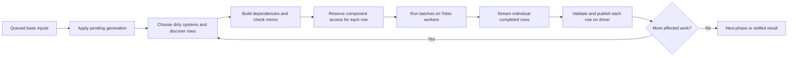

# Scheduler investigation and prior art

Status: source audit and research, 2026-10-24. This describes the pre-refactor
state. The subsequent [compact execution records](compact-execution-records.md)
replace the separate running/reader/reservation-owner tracking structures.
Subsequent [planner activation experiments](planner-activation-round.md) retain
quiet-wave gating and sealed metadata reuse, but archive consumer-bitset routing
after measurement. The proposals below are not all implemented.
This supplements the [warmed CPU profile](warmed-purchase-profile.md) and
[optimization roadmap](optimization-roadmap.md); it does not resume all roadmap tasks.

The measured limit is the shared evaluator driver. A better worker queue alone
cannot remove row discovery, dependency construction, reservations, or publication.
The closest comparisons combine incremental rule matching, dataflow/query engines,
and ECS access scheduling. None is a drop-in implementation of all our semantics.

## Current execution, from actual code



| Step | Code | What actually happens |
| --- | --- | --- |
| Own evaluation | `bowl.rs::ensure_evaluated`, `run_evaluation` | One caller holds the runner guard; others wait for generation progress. Memo state belongs to the active evaluator guard. |
| Select systems | `bowl.rs::run_phase_streaming`, `BoxedSystem::peek_needs_planning` | Scan phase systems, compare interested-store watermarks, inspect forced-dirty rows. |
| Build hints | `run_phase_streaming`, `SystemParam::states_hinted` | Eligible systems slice a shared write log, filter relevant types, sort/deduplicate entity IDs; bound joins expand member changes to providers. Complex products can fall back to full enumeration. |
| Discover invocations | `system.rs::plan_prepared_with_scratch` | Enumerate rows, form `(system, entity keys)`, collect dependencies, check memo equality. Construct access metadata only for misses. |
| Build runnable rows | `FunctionSystem::plan_rows`, `plan_sync_rows` | Transfer pooled command storage; construct one closure/future per row, share snapshot/prepared context, clone identity, extract written rows. |
| Admit | `dispatch/plan.rs::dispatch_rows`, `access.rs::Reservations` | Hash running identities, check/reserve access, record reader identities, divide read/write work into batches. |
| Execute | `dispatch/executor.rs::spawn_with`, `spawn_calls` | A task per batch. Async batches poll a bounded future set; sync batches call functions in a loop. Fetching still acquires component guards. |
| Return | `SpawnedBatch`, `dispatch.rs::Queue` | Each row sends a completion. The driver merges batch streams with `SelectAll`; a single-row batch uses a join handle. |
| Publish | `bowl.rs::commit_system_run` | Lock state, validate captured deps, apply commands, replace derived outputs, reconcile writes, refresh self-written deps, update memo, handle removals. |
| Release/repeat | `run_phase_streaming` | Remove running/reservation records; replan on changed output, stale completion, or released conflict. Ready completions are drained before deciding to replan. |

Phases remain Startup when needed, Evaluate, Complete, followed by the settling
machinery and Settle. Same-phase evaluation can iterate to a fixed point. This is
not a static DAG that executes every node exactly once.

The actual code is the authority: some older comments still describe cloning
memo state per wave or waiting for all system futures. The streamed path borrows
the evaluator's memo and publishes ready rows without waiting for every sibling.

### What batching currently saves

```text
16 rows -> one Tokio task
        -> 16 row identities
        -> 16 sets of dependencies and access records
        -> 16 reservation/publication lifecycles
        -> 16 streamed completions
```

`grain` adapts rows/task to ready count and worker count, capped by the configured
maximum (16 in the measured fixture). This is task batching, not a batch-oriented
planner or publisher. Do not propose "add batching" without saying which layer.

### Existing optimizations to preserve

- Schema presence masks and shared dense component-store slots.
- Prepared typed store access and dependency slot hints.
- Watermark skipping and entity-delta hints, including bound-provider expansion.
- Pair-driven indexed joins rather than unconditional Cartesian products.
- Memo-hit access construction avoided; reusable planning/command arenas.
- Shared immutable row context, compact keys, typed sync/async worker batches.
- Immediate ready-row publication even while another async row is pending.

These are implemented, not prospective gains. A consumer worklist extends the
watermark/hint system; it does not replace an entirely naive full-world scan.

## Concrete purchase accounting

The current eight-worker diagnostic run counts, per purchase:

| Work | Count |
| --- | ---: |
| Candidate rows considered | 10 |
| Memo hits | 5 |
| Executed/admitted kernels | 5 |
| Collected dependency records | 58 |
| Constructed access records | 29 |
| Publication freshness checks | 29 |
| Buffered commands | 2 |
| Reconciled writable rows | 4 |
| Stale publications / conflicts deferred | 0 / 0 |

Source interpretation of the five executions:

```text
validate wallet -> Debit artifact
validate inventory -> Grant artifact
apply -> wallet, inventory, sequence, outcome change in place
validate wallet again -> early return -> old Debit retracted at publication
validate inventory again -> early return -> old Grant retracted at publication
```

The final two calls have lifecycle meaning despite doing no purchase arithmetic.
The engine cannot infer the `outcome.is_some()` predicate inside arbitrary Rust
functions. Avoiding those calls requires an explicit eligibility/retraction
contract or a cheaper empty-output path, not silently discarding them.

In the CPU profile, publication is about 29%, planning about 21–22%, and admission
plus reservation bookkeeping about 14–18% with eight workers. Execution/runtime
contexts contribute roughly a quarter. These are sampled CPU shares, not wall
latency fractions. See the profile for uncertainties and exact measurements.

## Source findings beyond the sampled categories

### Repeated identities and hashes

A `SystemInvocation` contains a system ID and entity-key vector. Copies appear
in planned work, running sets, reader sets, reservation ownership, output ownership,
and memo updates. `finish_invocation` clones the owner for outputs. Dispatch
clones it for running/reservation/read tracking. Hashing is paid across these
structures even though they refer to the same logical invocation.

Proposed representation, not implementation:

```rust
struct InvocationId { slot: u32, generation: u32 }

struct InvocationRecord {
    // Own the full logical key once; index it at discovery.
    key: InvocationKey,
    // Store memo, access/ownership state and scheduling flags by numeric ID.
    // Exact fields depend on cancellation and reclamation policy.
}
```

Keep a key-to-ID lookup where row discovery requires it. Carry only the ID through
execution/commit queues. Slot generations or another reclamation protocol must
prevent old completions from targeting reused records. Arbitrary joins still
have variable-length logical keys; this does not pretend every row is one entity.

### Dense store slots do not yet eliminate dynamic lookup

`Dep` already caches a store slot, but revision reads still search a per-store
BTreeMap for the entity. `Dep::refresh_written` uses the type-ID path instead of
its cached slot. `Reservations` is still indexed by TypeId, then entity, and
invocation ownership. `BoxedSystem` interest checks still use TypeId metadata.

First extend existing slot use. Then separately evaluate a compact live revision
index or stable generational row handle. Snapshot entry references cannot simply
be reused as the live revision: COW maps, replacement, absence and deletion matter.

### Small result shape, general containers

Ordinary `plan_rows`/`plan_sync_rows` produce `SystemRun` with a one-element
`outputs` Vec and one-element `memo_updates` Vec. Hooks/grouped execution can
produce multiple values. A single-row representation with a many-row fallback
could avoid these allocations without changing the public API or requiring unsafe.

### Always-on shared statistics

`timed`/`timed_call` take clock readings and update `SystemStats::run_nanos` and
`runs` atomically even when optional `metrics` are off. Rows of one system share
those counters. This creates a possible cache-line contention point and a cost
inside the supposed ordinary production path. The profile does not establish
its isolated magnitude.

Measure runtime-selectable counters-off and batch-local aggregation variants with
the same Cargo features. Padding cannot remove contention on the same counter;
local accumulation/reduction can. Preserve the meaning of the public profiling API.

### Two different access protections

`Reservations` governs engine invocations. `ComponentCell` separately uses a
Mutex/Condvar readers-writer protocol plus guard-owned Arcs. External scoop read
guards are not represented merely by the scheduler's running-row bitset.
Therefore "the scheduler knows this row is exclusive" is not currently sufficient
to remove cell synchronization. It may become sufficient under a redesigned
external-access/epoch contract; that is a separate semantic change.

## Prior art and the applicable lessons

The following are primary documentation, source, or research papers. The proposed
Porridge mappings are our inference, not claims made by those projects.

| Prior art | Established mechanism | Potential Porridge use | Important mismatch |
| --- | --- | --- | --- |
| [Drools Phreak](https://kie.apache.org/docs/10.0.x/drools/drools/rule-engine/index.html) | Lazy rule evaluation, shared node/segment memories, linking/dirty masks, collection-oriented propagation | Compile query interests into activation metadata; batch changed rows through shared matching stages | Rule-engine semantics are not our async mutation/guard contract; adopt mechanisms, not the whole engine |
| [Timely activations](https://docs.rs/timely/latest/timely/scheduling/activate/index.html) and [active-operator scheduling](https://github.com/TimelyDataflow/timely-dataflow/blob/master/CHANGELOG.md) | Explicit activation; scheduling active work rather than every operator | Component-slot to interested-system routing and coalesced ready worklists | Global quiescence still includes pending inputs, async work and unpublished completions |
| [Differential arrangements](https://timelydataflow.github.io/differential-dataflow/chapter_5/chapter_5.html) | Shared indexed batches of updates, reused across operators | Incremental join candidate/index maintenance; avoid rediscovering unchanged relations | Extra retained state and compaction/retraction work can outweigh savings on small workloads |
| [Bevy executor source](https://docs.rs/bevy_ecs/latest/src/bevy_ecs/schedule/executor/multi_threaded.rs.html) | Precomputed conflict metadata, dependent lists/counts, ready/running/completed bitsets and completion queue | Dense system state and compiled access broad-phase tests | Bevy schedules systems; we also discover dynamic per-row invocations and can run disjoint rows of conflicting system types |
| [Salsa algorithm](https://salsa-rs.github.io/salsa/reference/algorithm.html) and [memo metadata](https://salsa-rs.github.io/salsa/plumbing/terminology/memo.html) | Revision-based verification, unchanged-output cutoff, durability summaries | Cheap unchanged-store gates before dependency traversal, cached verification within an unchanged live revision | Our world can change several times within a phase and in-place writers cannot be rolled back like pure recomputation |
| [DuckDB execution](https://duckdb.org/docs/current/internals/vector) and [binding](https://www.duckdb.org/docs/current/internals/overview) | Typed vectors/chunks and bound indexed references | Resolve metadata once; process chunks rather than materializing a scheduling object per scalar row | Arbitrary Rust kernels and individually pending futures are not automatically vectorizable relational operators |
| [Morsel-driven parallelism](https://db.in.tum.de/~leis/papers/morsels.pdf) | Workers process data chunks through operator pipelines with locality-aware scheduling | Chunk-level planning/preparation/execution, partition-local state | Pipeline fusion requires proving dependencies, retractions and visibility boundaries; schema types alone do not prove that |
| [Rayon producers](https://docs.rs/rayon/latest/rayon/iter/plumbing/trait.Producer.html) | Splittable work ranges with configurable/adaptive granularity | Drive prepared row ranges on workers without constructing every job centrally | Fork-join completion must not delay an unrelated ready async result |
| [Tokio scheduler design](https://tokio.rs/blog/2019-10-scheduler) and [Taskflow](https://taskflow.github.io/papers/tpds21-taskflow.pdf) | Worker-local queues, controlled stealing/wakeup, reduced allocation/refcounts, locality | Coalesced completion notifications, local continuations, persistent workers if justified | Tokio already provides work stealing; replacing it does not distribute our serialized publisher |
| [rustc IndexVec](https://doc.rust-lang.org/stable/nightly-rustc/rustc_index/) and [slotmap](https://docs.rs/slotmap/latest/slotmap/) | Typed dense indexes; versioned recyclable handles | Component/row/invocation IDs and reusable scheduling storage | Adopt the layout principle; no need to depend on compiler-private APIs |

A particularly close match is Phreak's combination of compiled matching metadata,
bitmasks and batched propagation. The useful endpoint is an incremental work graph,
not merely an atomic bitmap replacing a queue.

## Candidate design

```text
At build:
  schema slots + system query/access declarations
    -> consumer lists, prepared metadata, conservative conflict masks

At publication:
  changed component slot + entity + structural change
    -> update live revisions / join indexes
    -> mark affected systems/rows dirty once

At admission:
  dirty row -> discover or look up stable InvocationId
    -> check memo/deps as required
    -> reserve exact row access
    -> publish prepared work range

At completion:
  InvocationId + outputs
    -> validate/apply using indexed metadata
    -> release reservations
    -> activate affected work
```

Static masks are broad-phase metadata. They cannot replace row-level checks:
`writes Wallet` is not a reason to serialize every unrelated wallet. Conversely,
a ready bit is not an exclusive-access token. Keep those concepts separate.

A system finishing can create more ready work, including work of the same type.
Cycles require convergence, not an assumed topological ordering. Missing optional
components, negative filters, outer joins and disappearing matches need explicit
invalidation routes as well as ordinary value writes.

## Per-system instrumentation follow-up

The first experiment below is complete: [system profiling overhead](system-profiling-overhead.md).
The runtime toggle is retained with default ON. Sync gains are modest and async
results mixed; no batch-local counter mechanism was added. This supports moving
focus to shared scheduling/publication metadata, not expanding statistics work.

## Ordered experiments

Each item is a separate measured change, not permission to implement the whole
list. Use the same feature graph, retain normal and contention fixtures, and
compare cycles/request as well as throughput, allocations and retained memory.

| Order | Experiment | Expected observable result | Boundary |
| --- | --- | --- | --- |
| 1 | Make row timing optional; aggregate counters per batch | Fewer clock reads and shared atomic updates; isolate possible multiworker contention | API still supplies meaningful stats when requested |
| 2 | Single-row result representation, grouped fallback | Remove two ordinary result Vec allocations/invocation | Same publication, panic and cancellation semantics |
| 3 | Dense component slots in reservations/interests/refresh | Fewer TypeId hashes | Preserve undeclared/custom-type fallback and cross-layout checks |
| 4 | Stable invocation IDs with persistent records | Fewer identity clones/hashes across running, ownership, memo and completion | Correct retirement, canceled work, stale completions and join key changes |
| 5 | Publication fast paths and indexed live revision metadata | Less BTree traversal / repeated ownership work | No skipped stale checks, missing optional deps or output retractions |
| 6 | Component-to-consumer activation and coalesced dirty sets | Fewer system scans, log filtering, duplicate candidates | Preserve full-plan fallback for opaque params |
| 7 | Chunk-oriented preparation, commit amortization and local counters | Reduce per-row overhead beyond Tokio task batching | Preserve row identity and early ready-result visibility |
| 8 | Shared completion storage/queue, wake coalescing, selective local continuation | Reduce batch stream nodes and scheduling roundtrips | No lost wakeups, no busy spin, prompt cancellation and panic delivery |
| 9 | Worker-assisted row planning or partition-owned execution/publication | Lower driver CPU/request and scale under real work | Cross-partition transactions, global settle and reclamation require design |

The first two isolate obvious bookkeeping costs. The structural center of the
plan is 3–6: represent known metadata once and activate only affected work.
A fully distributed scheduler is unlikely to help if every row still returns to
one expensive publication path.

Other useful experiments after those: trusted-internal-key hasher A/B (never
change arbitrary user-key hashing blindly), lazy fingerprint indexes only where
consumers require them, grouped ownership reconciliation, compact hot/cold
invocation metadata, sparse/dense adaptive dirty sets, generation-stamped sets,
inline thresholds, cache-line placement, indexed chunk storage, and opt-in
pipeline fusion for independently validated local partitions. None is a claimed
speedup until measured. More atomics do not automatically mean more parallelism.

## Where unsafe could earn its place

| Technique | Benefit to test | Required invariant |
| --- | --- | --- |
| Stable row/revision pointers | Remove repeated tree/index lookup | Storage remains pinned/alive; deletion/replacement detected; no stale snapshot pointer used as live state |
| Scheduler-issued component access | Remove redundant per-cell synchronization | All readers, including external queries and async lifetimes, participate in the access protocol |
| Intrusive ready/completion nodes | Reuse storage and avoid per-message allocation | Correct pinning, ownership transfer, cancellation and reclamation; prevent ABA |
| Disjoint chunk access | Parallel preparation or publication without coarse world borrow | Stable structural epoch, nonoverlap and correct command conflict treatment |
| Unchecked dense indexing | Remove a demonstrated remaining bounds check | Proven layout/ID validity, including internal/custom fallbacks |

Use ordinary safe indexing/ownership for the initial representation changes.
Unsafe is valuable when it encodes an already-established invariant; it cannot
make a semantically stale dependency current or a shared result safe to reclaim.
Narrow unsafe modules need written invariants, Miri coverage for pointer/drop
lifetimes, and bounded [Loom](https://docs.rs/loom/latest/loom/) models for the
relevant claim/wakeup/cancellation races. Those checks supplement semantic tests;
they do not prove every possible runtime behavior.

## Experiments that would give misleading results

- Increasing batch size while leaving all per-row work intact and calling it a
  batch-oriented engine.
- Replacing Tokio with Rayon and assuming publication is now parallel.
- Skipping dependency checks because the fixture happens to have no stale commits.
- Dropping output replacement/cleanup to reduce the five executions to three.
- Waiting for a whole batch to finish before exposing an already-ready result.
- Benchmarking a new graph with different correctness/visibility guarantees as a
  speedup over the old one without documenting the semantic difference.
- Removing guard locks without accounting for externally held query results.
- Treating every mask as atomic or running every tiny row as a separate task.

## Typed-return kernel proposal

[Typed-return kernels](typed-return-kernels.md) captures the proposed read-only
engine capability: synchronous functions return declared outputs directly, with
specialized result storage/publication. It distinguishes derived ownership from
state replacement, keeps async support, and does not promise global completion
ordering or compiler-enforced absence of all external side effects. This is a
separate experiment; it is not yet implemented or selected as the next task.

## Deferred allocation idea

Retain the two-lifetime arena idea for later: scratch resets at the end of a
planning scope; an owned output/batch region survives worker execution and
publication. Persistent memo data must not borrow a reset region. This can
reduce allocation traffic, but it is not a substitute for reducing identity,
lookup and scheduling work. No oversized thread-stack or arena rewrite is part
of this investigation.
