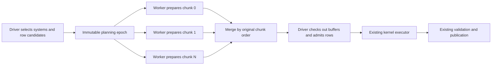

# Scaling investigation after compact execution records

Status: prototype measured and archived, 2026-10-24.
Committed implementation baseline: `bdcfd7f`. Candidate preparation was tested
on workers with fine and coarse chunks, then removed from production after no
throughput win. Publication was unchanged. The broad campaign remains paused;
this was a scoped follow-up. The proposal below records the tested design.

## Current evidence

[Machine-readable CPU counters, attribution and provenance](benchmarks/2026-10-24-post-ids-profile.json).
Raw evidence: `target/post-ids-profile-20261024-135028/`.

The separate frame-pointer build collected 252,546 samples across sixteen
processes: async/sync × 1/4/8/16 workers × two repetitions. Per-system statistics
were OFF; each process used 1,000 warmed request slots, five warmup rounds and
100 measured rounds. There were two empty callchains, no lost samples and no
observed depth-limit truncation. Unknown/inlined work remains explicit.

At eight/sixteen workers, sampled driver share remains about 75–77%. Publication
is about 31–33% of sampled CPU, planning 21–24%, and admission/reservations 10–12%.
The smaller reservation share is consistent with the preceding change, but
these are proportions of a different current run, not absolute before/after
CPU-cost measurements.

The ordinary frozen binary supplies independent hardware/software counters.
All PMU groups had full running coverage. Total task-clock per request is:

| Workers | Async CPU µs/request | Sync CPU µs/request |
| --- | ---: | ---: |
| 1 | 31.14 | 29.59 |
| 4 | 39.54 | 37.45 |
| 8 | 52.44 | 49.63 |
| 16 | 61.15 | 58.49 |

This is CPU time summed over all threads, not wall latency. Software counters
use one process per configuration; core counters use two. Normal user cycles
also increase with worker count, while instructions/request generally fall.
That is consistent with coordination/stall costs but does not identify a
specific mutex or cache line. Do not multiply frame-pointer driver shares by
ordinary-binary task-clock to manufacture exact driver CPU time. No new normal
throughput comparison was run; use the preceding paired throughput report.

All diagnostic configurations still execute five kernels and 29 revision checks
per purchase with zero stale publications. There is no evidence here of a
repeated-poll storm being responsible for the curve.

## Two concrete targets

### Remove avoidable shared spawn bookkeeping

Every worker invocation calls `snapshot.spawn_slots(&owner)` before fetching
parameters. This locks the shared `derived_spawns` map even when no entity is
spawned. `finish_derived_spawns` also visits that map during publication.
The purchase kernels only insert components onto existing entities or mutate
existing components, yet pay this setup.

The `spawn_slots` call-context share increases from roughly 0.3% at one worker
to 2.4–2.9% at eight/sixteen. Finishing spawn bookkeeping adds around 1–1.6%.
These contexts include more than locking; on-CPU samples do not measure blocked
waits, so contention remains a hypothesis to test.

A separate narrow control can defer spawn-state lookup until a kernel actually
spawns, or avoid the unneeded finish path when both prior and current spawn sets
are known empty. It must still reuse previous spawn IDs, retire old slots when
outputs disappear, handle deferred Settle spawns, and support cloned Commands.
Simply checking that this run spawned nothing is insufficient if previous slots
need clearing. Avoid replacing one shared lock with extra per-row Arc/key traffic
without measuring the result. This control should not be bundled into a parallel
planning A/B comparison.

### Distribute read-only candidate preparation

The main offload candidate is the row loop in
`system.rs::plan_prepared_with_scratch`:

```text
row state
  -> logical invocation keys
  -> captured dependency revisions
  -> compare with memo
  -> build access metadata for misses
  -> owned PlannedInvocation
```

For ordinary built-in queries, this uses an immutable structural snapshot and
read-only memo metadata. It does not fetch mutable component values or apply
commands. It is a cleaner initial concurrency boundary than live publication.

Not all sampled planning cost belongs to that loop. Row/join enumeration and
pool checkout also contribute; much of the planner is inlined. The measured
21–24% is not a guaranteed parallelizable fraction or predicted wall-time gain.

## Proposed first offload prototype



1. Extract the row-preparation loop into a typed routine reusable by serial and
   worker paths. Keep row enumeration/provider ordering on the driver initially;
   enumerate a captured snapshot once.
2. Move owned row-state chunks to existing Tokio workers. `SystemParam::State`
   is Send but not necessarily Sync, so do not assume borrowed parallel iteration
   is valid. Each chunk owns scratch/output storage; no shared bump arena lock.
3. Share immutable snapshot/prepared metadata and memo data for the planning
   interval. Compare memos and create dependencies/accesses in the worker chunk.
4. Return candidate vectors and recyclable scratch. Merge by chunk index so
   planning completion order does not silently change admission ordering.
5. Keep command-pool checkout, exact reservations, RunId allocation and live
   publication on the driver for this first experiment. No world mutations occur
   in planning jobs.

Use the existing worker pool and unchanged total thread budget. A second Rayon
pool would introduce oversubscription and invalidate a simple worker-count
comparison. Small plans, one-worker runs and no-runtime operation retain a serial
path. Start with a runtime opt-in and a few chunk-size choices (for example
128/256/512 candidate rows); no new Cargo features or public kernel wrapper.

Known built-in metadata preparation is the initial eligibility scope. Custom
parameter metadata may have ordering/thread assumptions despite Send/Sync data;
keep opaque/custom paths serial unless they opt into the required contract.

## The ownership work that must precede parallel execution

The evaluator currently owns a mutable HashMap memo in `EvaluationGuard`, and
cancellation restores it to `State`. We cannot borrow that map into ordinary
`tokio::spawn` tasks that may outlive the driving future.

The proposed approach is an explicitly owned, immutable planning epoch, potentially
using an Arc around the memo during preparation. Ordinary planning must not clone
the entire memo table on every wave. Mutation resumes only after all planning
readers release the epoch. The evaluation guard must own recoverable memo state
at every await point; moving it into jobs and leaving the guard empty would break
cancellation recovery.

Before implementing the parallel path, settle these details in code/tests:

- Which owner holds the authoritative memo while planning jobs run?
- How does cancellation restore usable state if synchronous jobs are already
  executing and cannot be aborted immediately?
- Can the normal path regain unique ownership without a full-map clone?
- If a rare cancellation uses a copy-on-write recovery fallback, what are its
  cost and latency bounds? Do not silently put that copy on the hot path.
- How are panics, preemption, dirty cursors and scratch storage recovered?

No borrowed-pointer lifetime extension is justified merely to satisfy spawn's
static bound. Safe owned epochs should be tried before a scoped unsafe executor.
Planning jobs are bounded CPU work, not arbitrary async kernels waiting on I/O.
Waiting for planning readers does not authorize waiting for all active kernels.
Keep the existing test where a ready result publishes while an unrelated async
kernel remains suspended, and add cancellation during planning itself.

## Why publication stays coordinated initially

`commit_system_run` validates against the live world, applies commands, replaces
owned outputs, reconciles in-place writes, updates memos, and cascades removals.
One completed row can invalidate another row's captured dependencies. Checking
all rows against one old snapshot and then applying them unchecked changes the
contract.

To parallelize publication later, we need explicit nonconflicting write/ownership
partitions or staged commits with validated footprints. Existing command output
types do not fully describe runtime targets, relationship effects or removals.
The world, indexes and counters are not yet independently owned by such partitions.
Moving the same global lock to worker threads would distribute waiting, not work.

## Acceptance and stopping criteria

- [ ] Identical candidate/dependency/access decisions against the serial oracle
  on joins, optional/missing values, dirty hints, gates and custom fallbacks.
- [ ] Preserve output replacement, stale-result rejection, request ordering,
  async ready-result visibility, preemption and driver-cancellation recovery.
- [ ] No full-memo copy per ordinary planning wave; scratch capacity reused.
- [ ] Same-binary runtime serial/parallel comparison at 1/4/8/16 workers,
  including tiny plans, 1,000-row purchases, contention and sparse changes.
- [ ] Throughput improves with additional workers; total CPU/request and
  retained/peak memory remain acceptable. Report regressions at small sizes.
- [ ] Planning work moves to workers in a fresh profile. A hotter pool without
  faster requests is not success.

Driver CPU time per request needs a matched per-thread measurement to claim exact
movement; the current aggregate counters and sampled role shares are useful but
not interchangeable. Stop or narrow the prototype if dispatch, epoch ownership,
copying or allocations consume its gains. Publication remains a significant
serial limit even if planning offload succeeds.

## Prototype result: defer isolated preparation offload

[Fine-chunk measurements](benchmarks/2026-10-24-chunked-planning-fine.json) and
[coarse-chunk measurements](benchmarks/2026-10-24-chunked-planning-coarse.json)
contain paired samples, allocation/work counters and frozen-binary provenance.
Eight workers, 1,000 request slots, statistics off, five warmup rounds, ten
measured rounds and three alternating process repetitions per comparison:

| Kernel | Chunk policy | Serial µs/purchase | Worker preparation µs/purchase |
| --- | --- | ---: | ---: |
| Async | Fine, cap 16 | 24.95 | 25.41 |
| Async | Fine, cap 32 | 24.46 | 25.61 |
| Async | Fine, cap 64 | 25.07 | 25.51 |
| Sync | Fine, cap 16 | 24.63 | 24.94 |
| Sync | Fine, cap 32 | 24.99 | 25.47 |
| Sync | Fine, cap 64 | 25.29 | 26.18 |
| Async | Exact 128 | 24.78 | 26.77 |
| Async | Exact 256 | 25.47 | 27.91 |
| Sync | Exact 128 | 27.25 | 27.52 |
| Sync | Exact 256 | 25.41 | 29.13 |

These are individual paired comparisons, not a cross-row ranking under identical
machine load. Fine policy uses min(cap, ceil(rows / (workers * 2))); coarse policy
uses the configured maximum. Jobs are bounded by the existing worker count.

Offload was active: 300,000 rows prepared across 30 measured rounds per case.
Normal execution made zero full-memo copies and zero stale publications; each
purchase retained five kernel starts and 29 revision checks. Fine cap 64 added
about 603 allocations and 297 reallocations per iteration; cap 16 added about
2,248 and 615. Coarser jobs reduced job count but did not improve throughput.

The complete source and tests are preserved in
[the replayable patch](benchmarks/2026-10-24-chunked-planning.patch), applying to
clean commit `bdcfd7f9a7e5ae858a943727e0f895ea974f8bef`. It includes the profiling
runner controls used during the investigation. The patch contains the final
exact-chunk variant; replacing `let grain = maximum;` in `system/parallel.rs`
with `let grain = states.len().div_ceil(workers.saturating_mul(2)).min(maximum).max(1);`
reproduces the fine policy. The patch was checked both in reverse against the
prototype and forward against the base index before restoring engine sources.

Prototype validation passed: 181 engine tests, workspace tests, benchmark smoke
and playground. Added tests covered metadata ordering/equivalence, optional and
negative filters, joins, dirty hints, memo hits, custom metadata affinity,
cancellation with active readers, panic recovery, async sibling visibility and
contended ordering. Normal memo ownership returned without copying; cancellation
could take an explicit recovery copy. No new unsafe code was introduced.

The full worker-count matrix, retained-memory study and fresh CPU profile were
not run because the initial eight-worker acceptance screen failed. Dispatch,
allocation, epoch handling and merging collectively outweighed this offload's
benefit; these measurements do not isolate their individual costs. Preparation
and kernel execution still require separate worker round trips and driver
admission/publication. A larger fused unit of work remains an untested option,
not a demonstrated win. Production retains serial preparation.
